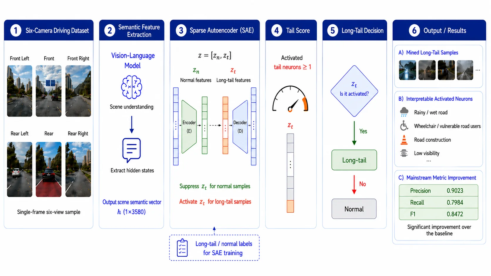

# Long-Tail Driving Scene Discovery

Screen multi-camera driving keyframes for long-tail candidates that need human
review, using frozen VLM features and a tail-guided sparse autoencoder (SAE).
The current evaluation question is whether the SAE improves candidate ranking
and review yield over Logistic regression and a small MLP on the same scenes.

## Team and contribution

This is a team capstone research project by Yike Chen, Zihua Chen and Yusong
Zhao. The roles below describe each contributor's technical project work.

| Contributor | Contributions |
|---|---|
| **Yike Chen** | Implemented the SAE feature-extraction and training code; led the precision-oriented long-tail evaluation; participated in ablation experiments and selected feature interpretation. |
| **Zihua Chen** | Developed the local annotation platform; performed manual review of model-generated labels; participated in SAE feature extraction. |
| **Yusong Zhao** | Participated in ablation experiments and SAE feature extraction; led most of the learned-feature interpretation and analysis. |

The reported results reflect the team's shared experimental work. This table
preserves the contribution statement at `b57eaffa`; original reports and run
records remain necessary to trace individual claims. The current AI-assisted
software and documentation refactor is recorded separately in
[feedback status](docs/feedback-status.md), and is not evidence of Yike's
original capstone implementation.

## Evidence and results

| Protocol / artifact | Result | Status |
|---|---|---|
| Historical random-frame 80/20; held-out loss selected checkpoint | SAE tail F1 0.8472, AP 0.9082 | Historical, not reverified from original predictions or checkpoint |
| Current scene-disjoint 70/15/15; independent validation | No real-data result yet | Frozen-manifest evaluation and controlled comparisons are prepared |
| CPU ResNet18; internal mini 6/2/2-scene split | 80 real timestamps / 480 images extracted into 3,072-dimensional vectors | Data and extraction verified; manual labels and model evaluation pending |
| CPU pilot with provisional AI visual labels | Four models trained/evaluated on 73 retained timestamps; seven uncertain frames screened separately | Human verification pending; reward/no-reward SAE identical; validation precision target unreachable; [record](docs/ai-pilot.md) |
| Synthetic end-to-end workflow | Four trained models, reload checks, 40 new unlabelled samples and 28 real HTTP route checks passed | Software verification; no nuScenes effectiveness claim |

Historical raw-VLM numbers cannot currently be reconciled with the stated
486 tail / 832 normal test supports, so they do not establish a matched-test
comparison. The reported dataset total also has an unexplained six-frame
count difference. See [historical results and caveats](results/README.md).

To start without nuScenes or a GPU, follow the [from-zero real-data guide](docs/from-zero.md).
The [portable Jupyter/Colab notebook](notebooks/driving_from_zero.ipynb) embeds
the source and covers acquisition, saved review decisions, pinned extraction
and a validated four-method comparison. Its bootstrap and CPU handoffs have
fixture verification; a real-data/GPU notebook run remains unverified.

For a no-GPU experiment, use the [CPU-only notebook](notebooks/driving_cpu_from_zero.ipynb)
or [CPU image-feature route](docs/cpu-route.md). It uses a pinned pretrained
ResNet18 encoder and the same four screening methods, with a separate feature
protocol. On 2026-10-23, uploaded nuScenes mini parts were imported and all 80
real six-view timestamps were encoded on CPU. This verifies the data/extraction
route; it is not a Cosmos reproduction or a driving-effectiveness result.
The subsequent [AI-label pilot](docs/ai-pilot.md) completes four-method training,
saved-result evaluation and unlabelled screening. Its labels remain explicitly
AI provisional; its scores are not human-ground-truth accuracy.

## CPU quickstart

On the existing shared cloud worker, use
`bash scripts/cloud.sh setup` to verify the Driving interpreter and
`bash scripts/cloud.sh demo OUTPUT=output/cloud-demo` for a fresh CPU fixture run.
This reuses the worker while keeping Driving's interpreter separate from DWTS.
It does not create/publish a new platform environment or change network policy.

The CPU quickstart was verified with Python 3.12. Install the pinned CPU
requirements in a virtual environment, then use a new, empty output directory:

```bash
python3.12 -m venv .venv
source .venv/bin/activate
python -m pip install -r requirements-cpu-lock.txt
make e2e PYTHON=.venv/bin/python OUTPUT=output/e2e-example
```

This trains Logistic regression, MLP and matched SAE with/without reward on
60 synthetic scenes / 240 frames, checks checkpoint reloads and train-only
normalisation, then screens 40 independent unlabelled samples. `make e2e`
also starts real temporary HTTP servers and verifies the trained and screened
explorers, six images, search and review export. Use a fresh output path.

These software checks passed locally. Browser UI verification is tracked
separately in [testing](docs/testing.md). No VLM inference or real driving
performance was verified. See [end-to-end commands and artifacts](docs/e2e.md).

For the existing array-level fixture and evaluator commands, see
[controlled evaluation](docs/evaluation.md#cpu-fixture-commands). Real data and
trained weights are not included. For a new experiment, obtain authorised
nuScenes assets and create reviewed labels with the from-zero guide. Recover
the original labels, settings and checkpoints only when verifying historical
results; [the user guide](docs/user.md) explains the inputs.

## Pipeline



A single timestamp with six views becomes one frozen VLM feature vector. The
SAE learns sparse normal and tail subspaces; activation counts provide the
original decision rule and the tail-code norm provides a ranking score. The
neuron explorer links frames to active units and similar examples. The
[method and historical context](docs/methods-history.md) explain the objective.

## Reproduce and inspect

Use one frozen manifest for all methods and seeds, train-only normalisation,
validation-only checkpoint and operating-point selection, and a review budget
chosen before reading test results. Keep original fixed-rule metrics separate
from validation-selected thresholds. The [evaluation protocol](docs/evaluation.md)
describes AP/PR curves, precision@K, scene bootstrap intervals, per-sample
predictions, provenance and table reconstruction.

The [user guide](docs/user.md) covers labelling, extraction, manifest freezing,
training and the explorer. The [testing guide](docs/testing.md) separates CPU
checks from real-asset integration. The [execution checklist](docs/feedback-status.md)
tracks missing assets, experiments and demonstration requirements.

Remaining limits include scene leakage in the historical split, weak-label and
review quality, unverified neuron names/purity on independent test scenes, and
missing original experiment assets. Every final presentation should include
real FP/FN cases and verified individual responsibilities. This project screens
candidates for review; it does not establish a vehicle safety guarantee.

Built on [Cosmos-Reason1](https://huggingface.co/nvidia/Cosmos-Reason1-7B) and
[nuScenes](https://www.nuscenes.org/nuscenes). Code license: [MIT](LICENSE).
