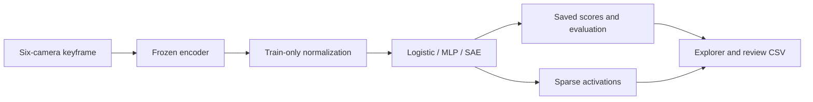

# Long-Tail Driving Scene Discovery

[](https://github.com/CCC917111/long-tail-driving-scene-discovery/actions/workflows/cpu.yml)
[](https://github.com/CCC917111/long-tail-driving-scene-discovery/actions/workflows/offline-browser.yml)
[](LICENSE)

**Rank six-camera driving frames for review and inspect the features behind each score.**
This project grew out of a team capstone on sparse autoencoders (SAEs). The
completed CPU follow-up connects image validation, four-model evaluation, saved
predictions and a browser explorer for reviewing sparse activations.

[**Demo guide**](demo/README.md) · [**Project card**](docs/project-card.md) · [**Presentation scripts**](docs/presentation.md) ·
[**Saved results**](results/human-ai-exposed-20261026/README.md) ·
[**Human review steps**](docs/human-review.md) ·
[**CPU quickstart**](#run-a-cpu-example)

Use the [downloadable new-scene viewer](demo/driving_new_scenes.html) to inspect
nine six-camera timestamps, or run the synthetic CPU example below. The fitted
comparison and later review batch are exploratory pilots with documented label
provenance and separate evaluation records.

## What the project does

For each timestamp, six camera views produce a score and sparse activations.
The explorer shows examples that strongly activate a selected unit and exports
a review queue. The experiment asks whether a tail-guided SAE improves review
yield over logistic regression and a small MLP with the same features and scenes.



The original research route uses Cosmos-Reason1 VLM features. The CPU follow-up
uses a pinned ImageNet ResNet18 and concatenates six 512-dimensional view
representations. It is a separate feature protocol from the Cosmos experiment.

## Supplemental new-scene review

The 2026-10-28 [supplemental record](results/new-scene-human-review-20261028/README.md)
contains nine judgments from two new scenes: five normal and four non-normal.
Across both batches, the repository records **89 timestamps, 12 scenes and 534
original images**, with 86 binary judgments and three uncertain decisions.
These are cumulative inputs; the later nine timestamps were not used for
training. The existing models trained with only three normal frames from one scene.

The reviewer had access to model-generated reference labels before the final
submission; per-frame judgment timing is unknown. Against those references,
the fixed SAE rule selects all nine frames (precision 44.4%, recall 100%).
Replaying the old validation-selected threshold, **6.074954873**, selects five
(precision 60%, recall 75%) without tuning on these nine labels. See the
[frozen-policy replay](results/new-scene-human-review-20261028/frozen_policy_evaluation.json).
All normal references come from one scene and all non-normal references from
the other, so class and scene are confounded. Selecting fewer candidates here
does not establish measured review-time savings or generalization.

## Latest fitted comparison

On 2026-10-26, Yike submitted 80 decisions: 12 normal, 65 tail and three
uncertain. The submission followed disclosure of model-generated reference
labels; this is a single-reviewer reference set, not independently blinded
annotation. The four CPU models were rerun with
unchanged features, scenes and seed-42 settings. Excluding uncertain decisions
leaves 48/14/15 train/validation/test timestamps. Test contains ten tail and
five normal references from two scenes.

| Method | Test AP | Precision@4 | Test recall at validation-selected operating point |
|---|---:|---:|---:|
| Logistic regression | 0.6143 | 0.50 | 0.00 |
| Small MLP | 0.5984 | 0.50 | 0.00 |
| AbsTopK SAE, no reward | 0.9353 | 1.00 | 0.20 |
| AbsTopK SAE, norm reward | 0.9353 | 1.00 | 0.20 |

The SAE operating point selects **two test frames**, both positive under these
references, and recalls two of ten positives. Its top-four ranking is a separate
policy. The reward and no-reward checkpoints are identical and also match the
earlier provisional-label pilot: changed references and retained IDs explain the new SAE AP,
not improved weights. The MLP selects a different epoch under the new validation
references. Training still has three normal frames from one scene and one seed.

The [full result record](results/human-ai-exposed-20261026/README.md) preserves
the initial ten judgments and four later revisions. The default HTML viewer
replays this run; the earlier provisional-label run remains archived.

The normal-core rubric asks whether visible conditions call for extra defensive
driving; it does not measure statistical rarity. nuScenes mini has no official
test split. The [earlier provisional-label pilot](docs/ai-pilot.md) and
[historical results](results/README.md) have separate protocols and records.

## Inspect the offline demo

Download [demo/driving_pilot.html](demo/driving_pilot.html) using GitHub's
**Download raw file** button, then open the saved HTML in desktop Chrome or
Edge. With the original four locally held ZIP parts, it displays six camera
views, learned activations, per-frame scores from all four methods, error
bookmarks and a downloadable review CSV. Images stay in your browser.

The default viewer contains 308 method values for 77 retained timestamps and
MLP error bookmarks under one fixed threshold. It embeds numeric outputs;
image inspection requires the matching ZIPs.
Without them, use the synthetic CPU quickstart. The
[demo guide](demo/README.md) explains access and the selected error examples.

<a id="cpu-quickstart"></a>

## Run a CPU example

Verified with Python 3.12. From a clean checkout:

```bash
python3.12 -m venv .venv
source .venv/bin/activate
python -m pip install -r requirements-cpu-lock.txt
make e2e PYTHON=.venv/bin/python OUTPUT=output/e2e-example
```

Use a fresh output directory. This trains four methods on **synthetic
images/features**, checks checkpoint reloads and train-only normalization,
rebuilds the table, screens 40 independent synthetic samples and checks 28
HTTP routes. It requires loopback networking; it does not download nuScenes
or measure driving accuracy. In a sandbox that blocks local sockets, run the
same workflow without HTTP checks:

```bash
.venv/bin/python scripts/synthetic_demo.py --output-dir output/cpu-example
```

[End-to-end guide](docs/e2e.md) · [Real-data CPU setup](docs/cpu-route.md) ·
[CPU notebook](notebooks/driving_cpu_from_zero.ipynb) ·
[Original VLM route](docs/from-zero.md)

## Team and contribution

**Yike Chen leads the repository modernization and delivery:** the CPU workflow,
experiment organization, review process, reproducibility materials and demo.

The original capstone is shared work by **Yike Chen, Zihua Chen and Yusong Zhao**.
The following roles preserve the contribution statement at `b57eaffa`.

| Contributor | Original capstone contributions |
|---|---|
| **Yike Chen** | Implemented SAE feature-extraction and training code; led precision-oriented evaluation; contributed to ablations and selected feature interpretation. |
| **Zihua Chen** | Developed the local annotation platform; manually reviewed model-generated labels; contributed to SAE feature extraction. |
| **Yusong Zhao** | Contributed to ablations and SAE feature extraction; led most learned-feature interpretation and analysis. |

## Evidence and reproducibility

Saved predictions and run metadata connect each result to its configuration,
input manifest, feature and checkpoint hashes, and training-source snapshot.
A separate reload audit reconstructed scores from all four checkpoints.
Raw image archives, original metadata tables, feature arrays and model weights
are excluded from Git. The [result bundle](results/cpu-mini-ai-pilot-20261023/README.md)
retains derived evidence and hashes.

CPU CI runs tests, lint and the synthetic-data HTTP workflow. Browser CI checks
desktop/mobile interaction with synthetic, watermarked ZIPs. Separately, Node
checks verified all 480 original image files byte for byte and all 308 displayed values in
the latest viewer; the archived pilot retains its separate 292-value proof.
See [verification scope](docs/testing.md).

| Read next | Purpose |
|---|---|
| [Project card](docs/project-card.md) | Task, contribution, evidence and a short presentation script |
| [Evaluation protocol](docs/evaluation.md) | Frozen splits, AP/PR, review budget, operating points and provenance |
| [Earlier reference-label pilot](docs/ai-pilot.md) | Actual setup, outputs, negative findings and limits |
| [Method and history](docs/methods-history.md) | Original VLM/SAE objective and references |
| [Testing](docs/testing.md) | Completed checks and what they establish |
| [Feedback status](docs/feedback-status.md) | Remaining human review and historical evidence gaps |

Built with [nuScenes](https://www.nuscenes.org/nuscenes),
[Cosmos-Reason1](https://huggingface.co/nvidia/Cosmos-Reason1-7B),
[PyTorch](https://pytorch.org/) and scikit-learn.
Project code: [MIT](LICENSE). Dataset and pretrained weights retain their own
access and license terms; ResNet18 attribution is in
[third-party notices](docs/third_party_resnet18.txt).
