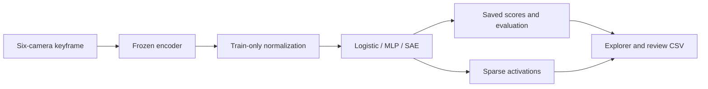

# Long-Tail Driving Scene Discovery

[](https://github.com/CCC917111/long-tail-driving-scene-discovery/actions/workflows/cpu.yml)
[](https://github.com/CCC917111/long-tail-driving-scene-discovery/actions/workflows/offline-browser.yml)
[](LICENSE)

**Find driving frames worth reviewing, then inspect why they were selected.**
This team capstone explores sparse autoencoders (SAEs) for ranking six-camera
keyframes. A reproducible CPU follow-up connects data validation, four-model
comparison, saved predictions and an offline neuron explorer.

[**Demo guide**](demo/README.md) · [**Project card**](docs/project-card.md) ·
[**Saved results**](results/cpu-mini-ai-pilot-20261023/README.md) ·
[**Human review steps**](docs/human-review.md) ·
[**CPU quickstart**](#run-a-cpu-example)

> **Current evidence:** the real-image CPU pipeline is complete. The pilot uses
> provisional AI visual labels; **zero labels have been verified by a human**.
> Its scores measure agreement with those references, not benchmark accuracy.

## What the project does

One timestamp from six cameras produces a candidate score, sparse activations,
similar high-activation examples and a review queue. The research question is
whether a tail-guided SAE improves review yield over Logistic regression and a
small MLP on the same frozen features and scenes.



The original research route uses Cosmos-Reason1 VLM features. The completed
CPU pilot uses a pinned ImageNet ResNet18, concatenating six 512-dimensional
views. These are separate feature protocols; the CPU run does not reproduce
the original Cosmos experiment.

## Completed real-image pilot

**Protocol `cpu-resnet18-six-camera-v1` · 2026-10-23 · seed 42 · review budget 4**

The run imported **80 timestamps / 10 scenes / 480 original images**, froze a
custom **6/2/2-scene** allocation before annotation, and retained **73 AI-labelled
timestamps** after excluding seven uncertain decisions. All methods share the
feature cache and manifest, train-only normalization and validation-only
model/threshold selection. Test support is **14 timestamps in two scenes:
9 AI-tail and 5 AI-normal references**.

| Method | Test AP, AI references | Precision@4 | AI-tail references found / 4 |
|---|---:|---:|---:|
| Logistic regression | 0.5857 | 0.50 | 2 |
| Small MLP | 0.5404 | 0.25 | 1 |
| AbsTopK SAE, no reward | 0.9216 | 1.00 | 4 |
| AbsTopK SAE, norm reward | 0.9216 | 1.00 | 4 |

Two findings matter when reading this table:

- **All four models missed the validation 90% precision target.** The saved
  operating-point policy predicts none, giving test recall zero. The SAE's
  original fixed activation rule instead flags every test frame.
- **The two SAE checkpoints are identical.** The capped reward was already
  saturated at initialization, so its gradient was zero. This run provides
  no evidence of an incremental reward benefit.

There are only three normal training frames, two test scenes and one seed.
The normal-core rubric identifies visible need for extra defensive driving;
it does not establish statistical rarity. Mini has no official test split.
Read the [full protocol and failure analysis](docs/ai-pilot.md), including
[three fixed-rule disagreements](results/cpu-mini-ai-pilot-20261023/failure_cases.json).
Historical random-frame results are preserved separately in
[the historical record](results/README.md); they have not been reverified.

## Inspect the offline demo

Download [demo/driving_pilot.html](demo/driving_pilot.html) using GitHub's
**Download raw file** button, then open the saved HTML in desktop Chrome or
Edge. With the original four locally held ZIP parts, it displays six camera
views, learned activations, per-frame scores from all four methods, error
bookmarks and a downloadable review CSV. Images stay in your browser.

The HTML contains cached numeric outputs, not raw images or a live model.
Without the matching parts, you can read its result summary; interactive image
inspection requires those parts. For a generated-data example requiring no
nuScenes access, use the quickstart below. The [demo guide](demo/README.md)
includes a 90-second walkthrough and the scope of its error examples.

## Run a CPU example

Verified with Python 3.12. From a clean checkout:

```bash
python3.12 -m venv .venv
source .venv/bin/activate
python -m pip install -r requirements-cpu-lock.txt
make e2e PYTHON=.venv/bin/python OUTPUT=output/e2e-example
```

Use a fresh output directory. This trains four methods on **generated
images/features**, checks checkpoint reloads and train-only normalization,
rebuilds the table, screens 40 independent generated samples and checks 28
HTTP routes. It requires loopback networking; it does not download nuScenes
or measure driving accuracy. In a sandbox that blocks local sockets, run the
same workflow without HTTP checks:

```bash
.venv/bin/python scripts/synthetic_demo.py --output-dir output/cpu-example
```

[End-to-end guide](docs/e2e.md) · [Real-data CPU setup](docs/cpu-route.md) ·
[CPU notebook](notebooks/driving_cpu_from_zero.ipynb) ·
[Original VLM route](docs/from-zero.md)

## Team and contribution

The original capstone is shared work by **Yike Chen, Zihua Chen and Yusong Zhao**.
These roles preserve the contribution statement at `b57eaffa`; original reports
and run records remain necessary to substantiate individual claims.

| Contributor | Stated capstone contributions |
|---|---|
| **Yike Chen** | Implemented SAE feature-extraction and training code; led precision-oriented evaluation; contributed to ablations and selected feature interpretation. |
| **Zihua Chen** | Developed the local annotation platform; manually reviewed model-generated labels; contributed to SAE feature extraction. |
| **Yusong Zhao** | Contributed to ablations and SAE feature extraction; led most learned-feature interpretation and analysis. |

The later CPU workflow, provenance hardening, tests, offline tools and this
documentation are **AI-assisted follow-up work**, recorded separately from
original capstone authorship. The pilot annotations were produced by an AI
visual assistant and remain pending independent human review.

## Evidence and reproducibility

Each published result row links through saved predictions and run metadata to
its seed, configuration, manifest, feature hash, checkpoint hash and actual
training-source snapshot. The independent audit reloaded all four local models
and reproduced scores. Raw images, original metadata tables, feature arrays
and model weights are excluded from Git; derived evidence and hashes are
retained in the [result bundle](results/cpu-mini-ai-pilot-20261023/README.md).

CPU CI runs tests, lint and the generated-data HTTP workflow. Browser CI checks
desktop/mobile interaction with synthetic, watermarked ZIPs. Separately, Node
checks verified all 480 original image bytes and all 292 displayed model values.
See [verification scope](docs/testing.md).

| Read next | Purpose |
|---|---|
| [Project card](docs/project-card.md) | Task, contribution, evidence and a short presentation script |
| [Evaluation protocol](docs/evaluation.md) | Frozen splits, AP/PR, review budget, operating points and provenance |
| [AI pilot record](docs/ai-pilot.md) | Actual setup, outputs, negative findings and limits |
| [Method and history](docs/methods-history.md) | Original VLM/SAE objective and references |
| [Testing](docs/testing.md) | Completed checks and what they establish |
| [Feedback status](docs/feedback-status.md) | Remaining human review and historical evidence gaps |

Built with [nuScenes](https://www.nuscenes.org/nuscenes),
[Cosmos-Reason1](https://huggingface.co/nvidia/Cosmos-Reason1-7B),
[PyTorch](https://pytorch.org/) and scikit-learn.
Project code: [MIT](LICENSE). Dataset and pretrained weights retain their own
access and license terms; ResNet18 attribution is in
[third-party notices](docs/third_party_resnet18.txt).
